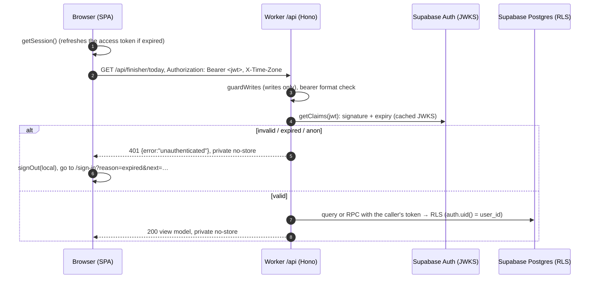

# Authentication: architecture

## Metadata

- Feature slug: `auth`
- Status: `ready`. Revised on 2026-10-11 for the SPA and Worker API ([ADR-0003](decisions/ADR-0003-spa-and-worker-api.md)); the earlier Next.js design is in git history and [ADR-0001](decisions/ADR-0001-supabase-auth-ssr.md), which is superseded.
- Requirements: [requirements/auth.md](../../requirements/auth.md), AUTH-001 to AUTH-010
- Design: the [app-shell design](../../output/designs/app-shell/design-notes.md) has the sign-out control and the post-sign-in Home page. The auth page designs (`output/designs/auth/`) are not yet created.
- Sources (recheck when changing auth):
  - [supabase-js Auth](https://supabase.com/docs/reference/javascript/auth-api) (`getClaims`, `exchangeCodeForSession`, `verifyOtp`)
  - [PKCE flow](https://supabase.com/docs/guides/auth/sessions/pkce-flow)
  - [Passwords](https://supabase.com/docs/guides/auth/passwords)
  - [Passwordless email](https://supabase.com/docs/guides/auth/auth-email-passwordless)
  - [Google](https://supabase.com/docs/guides/auth/social-login/auth-google)
  - [Redirect URLs](https://supabase.com/docs/guides/auth/redirect-urls)
  - [JWT signing keys](https://supabase.com/docs/guides/auth/signing-keys)
  - [Workers static assets](https://developers.cloudflare.com/workers/static-assets/)

## Context and constraints

- Stack (CLAUDE.md, ADR-0003):
  - the SPA is Vite + React with TanStack Router;
  - the API is Hono on one Cloudflare Worker, which also serves the SPA's static assets on the same origin;
  - Supabase Auth; the app has no password system of its own.
- Sign-in methods: password, magic link or email OTP, and Google.
- Access model: invitation only. Public sign-up is disabled.
- The browser Supabase client keeps the session (access and refresh tokens) in `localStorage` and refreshes it.
- The API is stateless. It sees only the access token in the `Authorization` header.
- `getClaims(token)` checks the token's expiry and signature:
  - with asymmetric signing keys (the default for new projects), locally against the project's JWKS, which supabase-js caches per Worker isolate;
  - with symmetric keys, with the Auth server (`getUser`).
- The browser's `getSession()` is used only to decide navigation and to attach the token. It is never an authorization check.

## Components

| Path | Responsibility |
| --- | --- |
| `src/lib/supabase/client.ts` | The one browser Supabase client: PKCE flow, persisted session, auto-refresh, and `detectSessionInUrl: false`. `sessionStatus()` and `currentSession()` serve route guards and the API helper. |
| `src/features/auth/api.ts` | All sign-in flows as functions that never throw and return mapped codes (AUTH-008). `navigateTo()` does a full page load after sign-in or sign-out, so no previous-session state survives in memory. |
| `src/app/router.tsx` | Route guards. `requireSession` (shell) sends signed-out visitors to `/sign-in?next=…` and adds `reason=expired` when the stored session couldn't be refreshed. `redirectIfSignedIn` covers `/sign-in` and `/forgot-password`. The `/auth/confirm` and `/auth/callback` loaders run each single-use exchange once, then `location.replace` the URL. |
| `src/lib/api.ts` | `apiFetch()` attaches `Authorization: Bearer <access token>` (read fresh per call) and omits credentials. On a 401 it calls the handler from `src/main.tsx`, which signs out locally and opens `/sign-in?reason=expired&next=…`. |
| `src/worker/auth.ts` | `requireUser` middleware: parses the Bearer JWT, builds a per-request client (publishable key plus the caller's token), and calls `getClaims(token)`. It requires `sub`, `role = authenticated` and not anonymous, otherwise 401. Handlers read only `c.var.user` and `c.var.supabase`. |
| `src/worker/http.ts` | `noStore`, `guardWrites` (foreign `Origin` → 403, non-JSON write body → 415), `apiError`, and bounded `readJsonObject`. |
| `src/main.tsx` | On `SIGNED_OUT` (in this tab or another), clears the query cache and re-runs the route guards. |

## Flows and routes

All flows run in the browser against Supabase Auth. The pages never show Supabase's error text. These are the mappings (`src/features/auth/api.ts`):

| Function (page) | Supabase call | Success | Failure the page shows | Req |
| --- | --- | --- | --- | --- |
| `signInWithPassword` (`/sign-in`) | `signInWithPassword` | full load of `safeNext(next)` | `invalid_credentials` for any auth error; `rate_limited`; `unavailable`; `network` | AUTH-001 |
| `sendSignInEmail` | `signInWithOtp({ shouldCreateUser: false, emailRedirectTo: origin + path of safeNext(next) })` | `sent` (also when the address is unknown or hit its per-address limit) | `rate_limited` (IP/client-wide only); `unavailable` | AUTH-002, 008 |
| `verifySignInCode` | `verifyOtp({ email, token, type: 'email' })` | full load of `safeNext(next)` | `invalid_code` | AUTH-002 |
| `startGoogleSignIn` | `signInWithOAuth({ provider: 'google', redirectTo: origin/auth/callback?next=…, skipBrowserRedirect: true })` | `location.assign(url)`, only if `url` is on the project's Supabase origin. The PKCE verifier stays in `localStorage`. | `unavailable` | AUTH-003 |
| `requestPasswordReset` (`/forgot-password`) | `resetPasswordForEmail(email, { redirectTo: origin/account/set-password })` | always `sent` | `rate_limited` | AUTH-005, 008 |
| `updatePassword` (`/account/set-password`, requires a session) | `updateUser({ password })`, which the Auth server checks against the live session | full load of `/home` | `weak_password`, `same_password`, `reauthentication_needed`, `unauthenticated` | AUTH-004, 005 |
| `signOut` (shell) | `signOut({ scope: 'local' })` | full load of `/sign-in?signed_out=1` | none (the local session is cleared anyway) | AUTH-006 |
| `/auth/confirm?token_hash&type&next` | `verifyOtp({ token_hash, type })`, where `type` ∈ {`email`, `recovery`, `invite`} | `location.replace(safeNext(next))`; invite and recovery go to `/account/set-password` | `/auth/error` | AUTH-002, 004, 005, 009 |
| `/auth/callback?code&next` (or `?error…`) | `exchangeCodeForSession(code)` | `location.replace(safeNext(next))` | `/sign-in?error=google_no_access` (sign-up refused) or `/sign-in?error=google` | AUTH-003 |

**Rate limits.** A per-address email-send limit (`over_email_send_rate_limit`) is reported as `sent`, because reporting it would reveal that the address exists. The page enforces its own 60-second resend cooldown. Only IP- or client-wide limits show "please wait".

**What the uniform wording does and doesn't do.** Anyone can call the Supabase Auth API directly with the publishable key and see its raw responses, so the uniform wording is about what the hub's pages disclose. Supabase's rate limits are the control against enumeration (R5).

### Every API request (AUTH-007, FIN-017)

### Email links, invitation and reset (AUTH-002, 004, 005)

The email templates are unchanged and point at `{{ .SiteURL }}/auth/confirm?token_hash=…`. That route is now an SPA page whose loader calls `verifyOtp` in the browser.

- Invitation: dashboard → Add user → **Send invitation** → `/auth/confirm?…&type=invite&next=/account/set-password` → set password → `/home`.
- Reset: `/forgot-password` → email → `/auth/confirm?…&type=recovery` → set password → `/home`.
- An email scanner (for example Microsoft Safe Links) that opens the link first uses up the token. The 6-digit code still works for magic links. For invitations and resets, the user requests a new link.

## Session lifecycle and revocation

- The browser keeps the session in `localStorage` (key `sb-<project-ref>-auth-token`). supabase-js refreshes the access token before it expires, and the API never sees the refresh token.
- **Revocation delay (R3).** A session revoked elsewhere (sign-out on another device, or the dashboard) is accepted by the API until its access token expires: up to the project's JWT expiry, 1 hour by default. After that, the refresh fails and the browser is signed out. Reducing the JWT expiry shortens the window.
- **Immediate checks.** The password change goes to the Auth server, which refuses a revoked session immediately.
- **Sign-out** clears the local session and revokes this session's refresh token (`scope: 'local'`). Another tab sees `SIGNED_OUT` and its guards redirect.
- **Cookies.** The hub sets none. Requests to `/api` use `credentials: 'omit'`.

## Configuration

### Supabase dashboard

| Area | Setting |
| --- | --- |
| Authentication → Sign In / Providers | **Allow new users to sign up: off.** Confirm email: on. Email provider: on. Google: on, with Client ID and Client Secret. Anonymous sign-ins: off. Manual linking: off. |
| Authentication → URL Configuration | Site URL = the production URL. Redirect URLs: `http://localhost:3000/**` (Vite dev), `http://localhost:4173/**` (`vite preview`), `https://person-hub.<account-subdomain>.workers.dev/**` and/or the custom domain `https://<prod-host>/**`. A host-wide wildcard is needed because magic links redirect to the requested app path. `safeNext` still restricts the final destination. |
| Authentication → Email templates | As below (unchanged). |
| Authentication → SMTP | **Set up custom SMTP before real use.** The built-in sender is limited to about 2 emails per hour (R2, requirements Q3). |
| Authentication → Rate limits / Attack protection | Keep the defaults and record their values in the test report. |
| Authentication → Passwords | Minimum length 8 (requirement assumption A2). Enable leaked-password protection if the plan offers it. |
| Project settings → JWT signing keys | Confirm **asymmetric** keys, so the Worker verifies tokens locally instead of calling the Auth server on every request. |
| Email OTP expiration | 3600 seconds (the default). This also controls invite and recovery links. |

### Email templates (use `{{ .SiteURL }}` with token hashes)

- **Magic link:** `{{ .SiteURL }}/auth/confirm?token_hash={{ .TokenHash }}&type=email&next={{ .RedirectTo }}`, plus the text "Or enter this code: {{ .Token }}".
- **Invite user:** `{{ .SiteURL }}/auth/confirm?token_hash={{ .TokenHash }}&type=invite&next=/account/set-password`.
- **Reset password:** `{{ .SiteURL }}/auth/confirm?token_hash={{ .TokenHash }}&type=recovery&next=/account/set-password`.
- **Confirm signup:** not used while sign-up is disabled. Point it at `/auth/confirm?…&type=email` anyway.
- `{{ .RedirectTo }}` is the full `emailRedirectTo` URL, so `safeNext` accepts a same-origin absolute URL and reduces it to its path.

### Google Cloud console

- OAuth client type: **Web application**.
- Authorized JavaScript origins: the production origin, `http://localhost:3000`, and `http://localhost:4173`.
- Authorized redirect URI: the Supabase callback shown on the dashboard's Google provider page (`https://<project-ref>.supabase.co/auth/v1/callback`).
- Scopes: `openid`, `…/auth/userinfo.email`, `…/auth/userinfo.profile`.
- While the consent screen is in **Testing**, add the owner's Google account as a test user.

### Environment variables

| Name | Where | Purpose |
| --- | --- | --- |
| `VITE_SUPABASE_URL`, `VITE_SUPABASE_PUBLISHABLE_KEY` | `.env.local` (build time; bundled into the SPA by design) | Browser Auth client |
| `SUPABASE_URL`, `SUPABASE_PUBLISHABLE_KEY` | `.dev.vars` locally; Worker variables set by the deploy workflow in production | Worker client acting as the caller |

All four are browser-safe values. The Google client secret is stored in Supabase. The secret key (`sb_secret_…`) is not added anywhere. Only `.env.example` and `.dev.vars.example` are committed.

## Threats and controls

| Threat | Control |
| --- | --- |
| Open redirect through `next` / `redirectTo` | `safeNext`: only a same-origin path starting with `/` but not `//` or `/\`, no control characters, not `/api`; otherwise `/home`. The Supabase redirect allowlist is the second layer. The Google URL must be on the project's Supabase origin. |
| Token theft through XSS (tokens are in `localStorage`) | CSP on the SPA (`script-src 'self'`, no inline scripts, `connect-src 'self' https://*.supabase.co`, `frame-ancestors 'none'`), React escaping, no `dangerouslySetInnerHTML` in app code, a small dependency set. **Residual risk accepted in ADR-0003.** |
| CSRF | Not applicable to Bearer auth: browsers don't attach the token by themselves. Defence in depth: a write with a foreign `Origin` → 403; a non-JSON write body → 415; no CORS headers. |
| Forged, expired or wrong-kind tokens | `getClaims(token)` verifies signature and expiry. The API requires `sub`, `role = authenticated` and not anonymous. `sub` is the only user ID; none is taken from input. |
| Elevated database access | The Worker has only the publishable key and acts as the caller, so RLS and the write-function checks always apply (ADR-0002). There is no service-role key. |
| Account enumeration | Uniform answers from the auth functions (AUTH-008). `shouldCreateUser: false`. Supabase rate limits (R5). |
| Unwanted account creation | Dashboard sign-up is off. `shouldCreateUser: false` on OTP. Google refuses unknown accounts. Test all three (T3). |
| Single-use secrets in history or logs | `/auth/confirm` and `/auth/callback` exchange once and then `location.replace`. Logs carry error types or codes only. `Referrer-Policy: strict-origin-when-cross-origin`. |
| Shared caching of personal data | Every API response is `private, no-store`. Personal data lives only in TanStack Query's in-memory cache, which is cleared on sign-out (and dropped by the full page load). The static SPA shell contains no personal data. |
| Clickjacking | `frame-ancestors 'none'` and `X-Frame-Options: DENY`. |
| Brute force or email flooding | Supabase's built-in rate limits. No in-memory counters in the Worker. |

## Risks and unresolved points

- **R1.** It isn't documented whether a pending, unconfirmed invitee who uses Google before accepting is linked or refused. Test on the real project. Until then, the invitation copy should say to open the invitation email first (requirements Q2).
- **R2.** The built-in SMTP limit (about 2 emails per hour) blocks magic-link use in practice. Custom SMTP is required before relying on AUTH-002, 004, and 005.
- **R3.** Revocation delay of up to the JWT expiry (see Session lifecycle).
- **R4.** Preview or staging deployments that share the production Supabase project can complete sign-ins if their origin is in the redirect allowlist. Add only origins you control, or use a separate Supabase project.
- **R5.** Rate-limit responses may differ between known and unknown emails. Test this, and keep the "please wait" message identical for all addresses.
- **R6 (new).** Tokens in `localStorage` are exposed to any script on the page. See ADR-0003's revisit triggers.

## Rollback

There is no database change. Roll back by deploying the previous Worker version (`wrangler rollback`) or the previous git revision. Dashboard settings are reversible. Keep sign-up disabled throughout.

## Test obligations (Tester)

- T1. Each of the three methods signs in an invited user and lands on `next` or `/home`, including `next` values that arrive through email links.
- T2. A wrong password, an unknown email and a known email produce identical page messages for password, OTP and forgot-password (automated against a stub in `tests/unit/auth-flows.test.ts`; still to be observed against Supabase).
- T3. No account is created through OTP with an unknown email, through Google with an unknown account, or through a direct `signUp` call using the publishable key.
- T4. Invite → set password → sign in with the password. Also test Google for an invitee before and after accepting (R1).
- T5. Expired, reused and tampered `token_hash` or `code` values go to `/auth/error` or show `invalid_code`.
- T6. `next` values such as `https://evil.test`, `//evil.test`, `/\evil.test` and `javascript:` all resolve to `/home`.
- T7. API: no token, malformed token, expired token, anon-key JWT → 401 with no data. A write with a foreign `Origin` → 403. A form-encoded write → 415. No `Access-Control-Allow-Origin` on any response.
- T8. Signed out: app pages redirect to sign-in with `next`. Signed in: `/sign-in` redirects to `/home`.
- T9. After sign-out, Back shows no personal content, and the old refresh token can't be reused.
- T10. API responses carry `Cache-Control: private, no-store`. SPA responses carry the CSP and frame headers from `public/_headers`.
- T11. The client bundle and the logs contain no secret key, tokens or email addresses.
