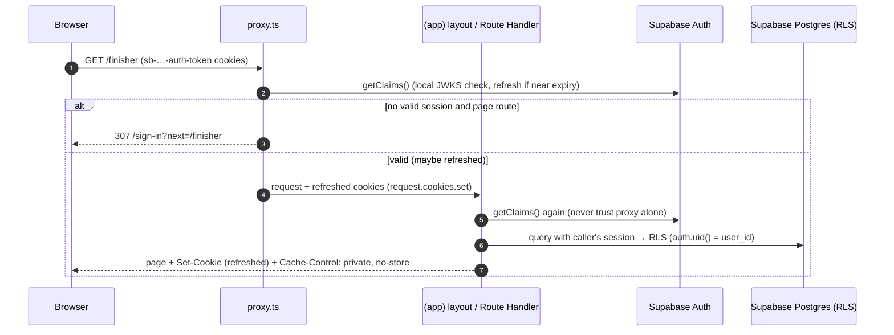
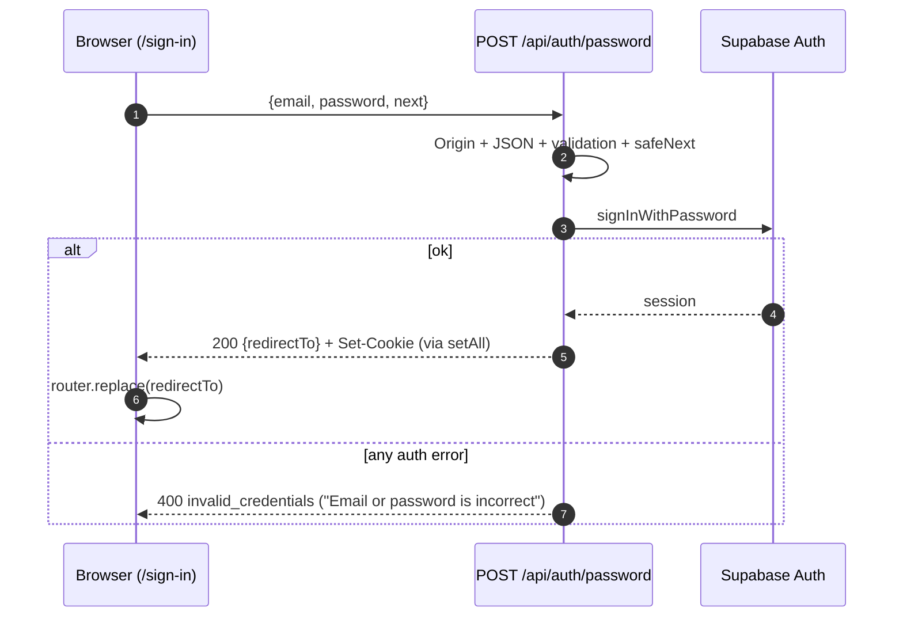
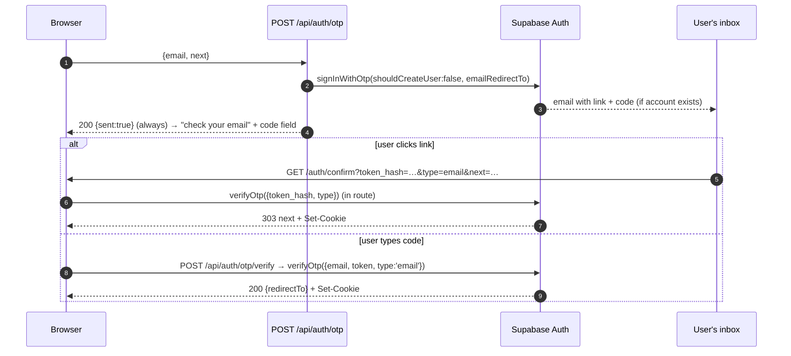
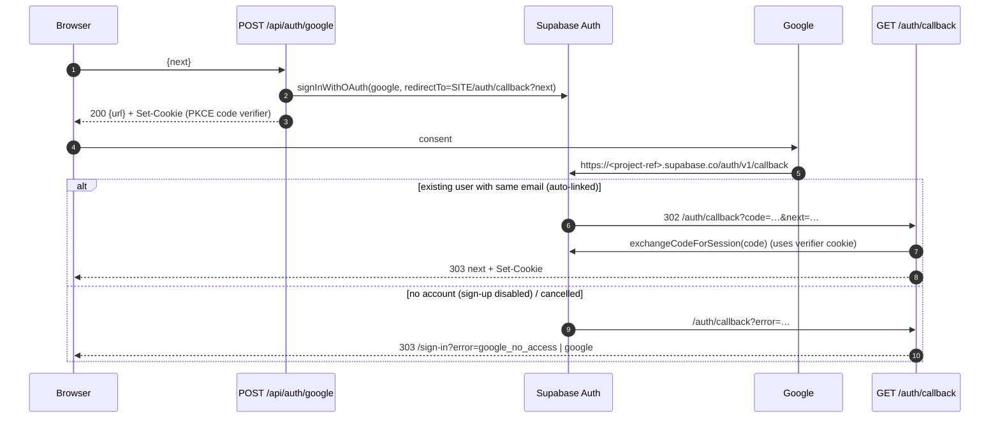

# Authentication: architecture

## Metadata

- Feature slug: `auth`
- Status: `ready`
- Date: 2026-10-11
- Requirements: [requirements/auth.md](../../requirements/auth.md), AUTH-001 to AUTH-010
- Decision: [ADR-0001: Supabase SSR cookie sessions with server-side auth routes](decisions/ADR-0001-supabase-auth-ssr.md)
- Design: the [app-shell design](../../output/designs/app-shell/design-notes.md) has the sign-out control and the post-sign-in Home page. The auth page designs (`output/designs/auth/`) are not yet created.
- Sources: official documentation checked on 2026-10-10. Recheck these when implementing:
  - [Supabase SSR client](https://supabase.com/docs/guides/auth/server-side/creating-a-client)
  - [Passwords](https://supabase.com/docs/guides/auth/passwords)
  - [Passwordless email](https://supabase.com/docs/guides/auth/auth-email-passwordless)
  - [Google](https://supabase.com/docs/guides/auth/social-login/auth-google)
  - [Redirect URLs](https://supabase.com/docs/guides/auth/redirect-urls)
  - [Users and invites](https://supabase.com/docs/guides/auth/users)
  - [Identity linking](https://supabase.com/docs/guides/auth/auth-identity-linking)
  - [Email templates](https://supabase.com/docs/guides/auth/auth-email-templates)
  - [Next.js proxy](https://nextjs.org/docs/app/api-reference/file-conventions/proxy) (v16.4 docs)

## Context and constraints

- Stack (CLAUDE.md): Next.js App Router with TypeScript, Supabase Auth, and Vercel. The app uses no separate password system.
- Sign-in methods: password, magic link or email OTP, and Google.
- Access model: invitation only. Public sign-up is disabled.
- The app has not been scaffolded yet. These are the technical decisions the Developer will implement.
- Version facts that shape this design:
  - Packages are `@supabase/ssr` and `@supabase/supabase-js`. Install supported versions during scaffolding and pin them through the lockfile.
  - Env vars use the **publishable key** (`sb_publishable_…`) in `NEXT_PUBLIC_SUPABASE_PUBLISHABLE_KEY`, not the legacy anon key.
  - The `setAll(cookiesToSet, headers)` cookie callback receives `Cache-Control`/`Expires`/`Pragma` headers. These must be applied to the response so CDNs don't cache it.
  - **Next.js 16 renamed `middleware.ts` to `proxy.ts`.** It runs on the Node.js runtime, and setting a runtime in it is an error. On Next.js 15 or earlier, `proxy.ts` is never called, so use `middleware.ts` there with the same Supabase code.
  - `getClaims()` verifies the JWT signature on every call: locally against cached JWKS when the project uses asymmetric signing keys (the default for new projects), and against the Auth server otherwise. **`getSession()` must never be trusted on the server.**

## Components

| Path (future) | Responsibility |
| --- | --- |
| `src/lib/supabase/server.ts` | `createClient()` builds a `createServerClient` with the publishable key and `cookies()` `getAll`/`setAll`, once per request. In Server Components, `setAll` is wrapped in try/catch because they cannot write cookies. |
| `src/lib/supabase/client.ts` | `createBrowserClient` (a singleton). It is not used for application data. It is reserved for any browser-only Auth call that is ever needed. |
| `src/proxy.ts` | Refreshes the session (FLOW-0) and redirects signed-out **page** requests to `/sign-in?next=…`. It adds `Cache-Control: private, no-store` and returns the Supabase response object together with its cookies. |
| `src/lib/server/auth.ts` (`server-only`) | `requireUser()` calls `getClaims()` and returns `{ userId: claims.sub, email }`, or throws an `Unauthenticated` error that route handlers map to 401. `requireFreshUser()` calls `getUser()` for sensitive operations. It also contains `safeNext(value)` and `assertSameOrigin(request)`. |
| `src/app/(auth)/…` | Pages outside the shell: `sign-in`, `sign-in/check-email`, `forgot-password`, `auth/error`. |
| `src/app/account/set-password/page.tsx` | Requires a session (an invited or recovering user). Outside the shell. |
| `src/app/api/auth/**/route.ts` | JSON POST endpoints (table below). |
| `src/app/auth/confirm/route.ts`, `src/app/auth/callback/route.ts` | GET landing routes for email links and OAuth. |
| `src/app/(app)/layout.tsx` | The shell. Calls `requireUser()` and redirects to sign-in if there is no user. |

**Why Route Handlers:** sign-in actions run on the server (ADR-0001). This means one place writes cookies, there are consistent Origin checks, Supabase errors are mapped to anti-enumeration messages, and no tokens are handled by browser code. The sign-in page is a Client Component that `fetch`es these JSON endpoints, so it can keep the typed email after an error without putting it in a URL.

## Routes

All `/api/auth/*` endpoints:
- accept only `POST` with `Content-Type: application/json` (other types get 415);
- require `Origin` to match the site origin (otherwise 403);
- validate the body (email ≤ 254 characters and well-formed; password 1–256 characters for sign-in or 8–256 for a new password; code of exactly 6 digits);
- pass the `next` value through `safeNext`;
- respond with `Cache-Control: private, no-store`;
- never echo Supabase error text.

| Method and path | Calls | Success | Failure (client sees) | Req |
| --- | --- | --- | --- | --- |
| POST `/api/auth/password` `{email, password, next?}` | `signInWithPassword` | 200 `{redirectTo}` + session cookies | 400 `invalid_credentials` (for any auth error); 429 `rate_limited`; 500 `unavailable` | AUTH-001 |
| POST `/api/auth/otp` `{email, next?}` | `signInWithOtp({ email, options: { shouldCreateUser: false, emailRedirectTo: SITE + '/auth/confirm?next=…' } })` | 200 `{sent: true}`, **including** when Supabase refuses because the user doesn't exist | 429 `rate_limited`; 500 `unavailable` | AUTH-002, 008 |
| POST `/api/auth/otp/verify` `{email, token, next?}` | `verifyOtp({ email, token, type: 'email' })` | 200 `{redirectTo}` + cookies | 400 `invalid_code` | AUTH-002 |
| POST `/api/auth/google` `{next?}` | `signInWithOAuth({ provider: 'google', options: { redirectTo: SITE + '/auth/callback?next=…' } })` | 200 `{url}`. The PKCE code-verifier cookie is set **on this response**, and the page then does `location.assign(url)` | 500 `unavailable` | AUTH-003 |
| POST `/api/auth/forgot` `{email}` | `resetPasswordForEmail(email, { redirectTo: SITE + '/auth/confirm?next=/account/set-password' })` | Always 200 `{sent: true}` | 429 `rate_limited` | AUTH-005, 008 |
| POST `/api/auth/password/update` `{password}` | `requireUser()` then `updateUser({ password })` | 200 `{redirectTo: '/home'}` | 401; 400 `weak_password` | AUTH-004, 005 |
| POST `/api/auth/sign-out` | `signOut({ scope: 'local' })` | 200 `{redirectTo: '/sign-in?signed_out=1'}` + cookies cleared | — (cookies are cleared anyway) | AUTH-006 |
| GET `/auth/confirm?token_hash&type&next` | `verifyOtp({ token_hash, type })`, where `type` ∈ {`email`, `recovery`, `invite`}. Any other value is rejected. | 303 → `safeNext(next)` (recovery and invite go to `/account/set-password`) | 303 → `/auth/error` | AUTH-002, 004, 005, 009 |
| GET `/auth/callback?code&next` (or `?error=…`) | `exchangeCodeForSession(code)` | 303 → `safeNext(next)` | `error` param or exchange failure → 303 `/sign-in?error=google`. A refusal because sign-up is disabled → `/sign-in?error=google_no_access` | AUTH-003 |

Rate-limit note: Supabase limits email sends per address and per time window, and a 429 for an unknown address could leak information. Wherever possible, map rate limits to the same generic "please wait" message for every address (AUTH-008). This is a residual risk to test (R5).

The two GET routes establish a session. They are a **documented exception** to "no state-changing GET": they are entry points that external redirects require, they are protected by single-use token hashes and PKCE verifiers, and they only ever sign in the user the token was issued for.

## Flows

### FLOW-0: every request (session refresh and protection) — AUTH-007

The proxy matcher excludes `_next/static`, `_next/image`, favicon, and static assets. Public paths (`/sign-in*`, `/forgot-password`, `/auth/*`, `/api/auth/*`) are not redirected, but the session is still refreshed on them. For `/api/*` the proxy **never redirects**: the handler's `requireUser()` returns 401. A signed-in user who visits `/sign-in` is redirected to `/home` (AUTH-007).

Proxy pitfall: return the `supabaseResponse` object that `setAll` last built. If you return a new response, copy its cookies and its `cache-control`/`expires`/`pragma` headers, or users get signed out randomly. Refresh the session in only one place per request, because refresh-token reuse detection can revoke the whole session.

### FLOW-1: email and password — AUTH-001

### FLOW-2: magic link or 6-digit code — AUTH-002

The code is also a workaround for email scanners (for example Microsoft Safe Links) that open links before the user does. If a scanner uses up the link, the code still works.

### FLOW-3: Google — AUTH-003

Supabase links a Google identity automatically to an existing user that has the same verified email. With "Allow new users to sign up" off, "only existing users can sign in", so an unknown Google account is refused.

### FLOW-4: invitation — AUTH-004

1. The owner opens Supabase Dashboard → Authentication → Users → Add user → **Send invitation**. The app needs no secret key, because there is no in-app admin.
2. The invite email template links to `{{ .SiteURL }}/auth/confirm?token_hash={{ .TokenHash }}&type=invite&next=/account/set-password`.
3. `/auth/confirm` calls `verifyOtp({ token_hash, type: 'invite' })` and redirects to `/account/set-password`, where the invitee is already signed in.
4. The page posts to `/api/auth/password/update`, which calls `updateUser({ password })`, and then redirects to `/home`.

### FLOW-5: forgot or reset password — AUTH-005

`/forgot-password` → POST `/api/auth/forgot` (always shows "sent") → the email links to `/auth/confirm?token_hash=…&type=recovery&next=/account/set-password` → `verifyOtp` → set-password → `updateUser` → `/home`.

### FLOW-6: sign out — AUTH-006

The shell footer button POSTs to `/api/auth/sign-out`. The handler calls `signOut({ scope: 'local' })`, which revokes this session's refresh token and clears the cookies. The client then navigates to `/sign-in?signed_out=1`. Because app pages are `private, no-store`, pressing Back cannot show cached personal content.

## Session lifecycle and revocation

- The access token (a JWT) is stored in `sb-<project-ref>-auth-token` cookies, set by `@supabase/ssr` and refreshed by the proxy shortly before it expires.
- `getClaims()` verifies the JWT locally. A session that has been **revoked**, by signing out elsewhere or by the dashboard, therefore stays accepted until the access token expires: up to the project's JWT expiry, 1 hour by default. Reducing the JWT expiry shortens this window. The refresh fails after revocation, so the user is signed out at the next refresh.
- Any operation that must see revocation immediately uses `requireFreshUser()` (`getUser()`, a network call to Auth). Initially this is only the password change.
- Cookie attributes: those set by `@supabase/ssr` (path `/`, `SameSite=Lax`, `Secure` in production). Do not override them to `SameSite=None`.

## Configuration

### Supabase dashboard (existing project)

| Area | Setting |
| --- | --- |
| Authentication → Sign In / Providers | **Allow new users to sign up: off.** Confirm email: on. Email provider: on. Google: on, with Client ID and Client Secret. Anonymous sign-ins: off. Manual linking: off. |
| Authentication → URL Configuration | Site URL = the production URL. Redirect URLs: `http://localhost:3000/**`, `https://*-<vercel-team-slug>.vercel.app/**` (previews; see R4), and exact production paths `https://<prod-host>/auth/confirm` and `https://<prod-host>/auth/callback`. |
| Authentication → Email templates | Edit the templates as listed below. |
| Authentication → SMTP | **Set up custom SMTP before real use.** The built-in sender is limited to about 2 emails per hour. Check a provider's current free tier before choosing one (open question Q3 in the requirements). |
| Authentication → Rate limits / Attack protection | Keep the defaults, and record their values in the test report. Optional CAPTCHA is not needed while sign-up is disabled. |
| Authentication → Passwords | Minimum length 8 (requirement assumption A2). Enable leaked-password protection if the current plan offers it. |
| Project settings → JWT signing keys | Confirm **asymmetric** keys, so that `getClaims()` verifies locally. |
| Email OTP expiration | 3600 seconds (the default). This also controls invite and recovery links. |

### Email templates (use `{{ .SiteURL }}` with token hashes, as the PKCE/SSR guides show)

- **Magic link:** `{{ .SiteURL }}/auth/confirm?token_hash={{ .TokenHash }}&type=email&next={{ .RedirectTo }}`, plus the text "Or enter this code: {{ .Token }}".
- **Invite user:** `{{ .SiteURL }}/auth/confirm?token_hash={{ .TokenHash }}&type=invite&next=/account/set-password`.
- **Reset password:** `{{ .SiteURL }}/auth/confirm?token_hash={{ .TokenHash }}&type=recovery&next=/account/set-password`.
- **Confirm signup:** not used while sign-up is disabled. Point it at `/auth/confirm?…&type=email` anyway, for consistency.
- The value of `next` from email templates still passes through `safeNext`. `{{ .RedirectTo }}` is the full `emailRedirectTo` URL, so `safeNext` must accept a same-origin absolute URL and reduce it to its path.

### Google Cloud console

- OAuth client type: **Web application**.
- Authorized JavaScript origins: `https://<prod-host>` and `http://localhost:3000`.
- Authorized redirect URI: the Supabase callback URL shown on the dashboard's Google provider page (`https://<project-ref>.supabase.co/auth/v1/callback`).
- Scopes: `openid` (add it manually), `…/auth/userinfo.email`, and `…/auth/userinfo.profile`.
- While the consent screen is in **Testing**, add the owner's Google account as a test user.

### Environment variables

| Name | Exposure | Purpose |
| --- | --- | --- |
| `NEXT_PUBLIC_SUPABASE_URL` | Browser-safe | Project URL |
| `NEXT_PUBLIC_SUPABASE_PUBLISHABLE_KEY` | Browser-safe | `sb_publishable_…` |
| `NEXT_PUBLIC_SITE_URL` | Browser-safe | The canonical origin, used for `redirectTo`/`emailRedirectTo` and the Origin check. On Vercel previews, fall back to `https://${VERCEL_URL}`. |

Sign-in needs **no server secret**. The Google client secret is stored in Supabase. The secret key (`sb_secret_…`) is not added to the app. Commit `.env.example` with placeholder values. `.env.local` is gitignored.

## Threats and controls

| Threat | Control |
| --- | --- |
| Open redirect through `next` / `redirectTo` | `safeNext`: only a same-origin path starting with `/` but not `//` or `/\`. Otherwise `/home`. The Supabase redirect allowlist is the second layer. |
| CSRF on auth POSTs (sign-out, password update, sign-in fixation) | An `Origin` check plus a JSON-only content type (a cross-site form cannot send `application/json` without a CORS preflight, which is not allowed). No CORS headers are sent. |
| Account enumeration | Uniform responses for password, OTP, and forgot-password (AUTH-008). `shouldCreateUser: false` errors are mapped to `sent: true`. Never echo Supabase messages. |
| Unwanted account creation | Dashboard sign-up is off. `shouldCreateUser: false` on OTP. Google refuses unknown accounts. Test all three (T3). |
| Session theft or replay | `Secure`/`HttpOnly`-capable SSR cookies. No tokens in URLs after the callback. Logs never contain tokens or codes. |
| Forged or stale identity on the server | `getClaims()` (signature verified) is used everywhere. `getSession()` is never used for authorization. `claims.sub` is the only user ID. |
| Shared caching of personal pages or auth responses | Proxy and handlers set `private, no-store`. The `setAll` headers are applied. App pages render dynamically. |
| Brute force or email flooding | Supabase's built-in rate limits. No in-memory counters. Recorded in the test report. |
| Link pre-fetch by email scanners | A code alternative for OTP. Invite and recovery fall back to "request a new link". |
| Leaking emails or tokens in logs and analytics | Log only error codes. Apply the `server-only` marker to auth helpers. |

## Risks and unresolved points

- **R1.** The documentation does not say whether a **pending, unconfirmed invitee** who uses Google before accepting the invite is linked or refused, because linking removes unconfirmed identities. Test this on the real project. Until then, the invitation copy should tell invitees to open the invitation email first (requirements Q2).
- **R2.** The built-in SMTP limit (about 2 emails per hour) blocks magic-link use in practice. Custom SMTP is required before relying on AUTH-002, 004, and 005.
- **R3.** Revocation delay of up to the JWT expiry (see Session lifecycle).
- **R4.** Vercel preview deployments use the same Supabase project as production unless separated, and the preview wildcard in the redirect allowlist lets any preview complete a sign-in. Mitigation: enable Vercel Deployment Protection on previews, or use a separate Supabase project for previews. Decide this at deployment time.
- **R5.** Rate-limit responses may differ between known and unknown emails. Test this, and keep the "please wait" message identical for all addresses.
- **R6.** Whether cookies set in a Route Handler through `cookies()` reach the browser on a JSON response, for the PKCE verifier in FLOW-3, must be verified on the scaffolded Next.js version.

## Implementation steps (when implementation is requested)

1. Scaffold Next.js 16 (App Router, TypeScript, Tailwind, shadcn/ui). Install `@supabase/ssr` and `@supabase/supabase-js`, and commit the lockfile.
2. Add `.env.example` and the two Supabase client modules, the `proxy.ts` file, and the `src/lib/server/auth.ts` helpers.
3. Build the auth pages from the Designer's `output/designs/auth/` reference, and add the auth routes listed above.
4. Protect the `(app)` layout. Wire Sign out in the shell.
5. Apply the dashboard, email-template, and Google configuration (a manual checklist; record what was changed and when).
6. Run the tests below. Then, after authorization, run a production build and deploy.

**Rollback:** sign-in is configuration plus code with no database migration. To roll back, revert the deployment. Dashboard settings are reversible. Keep sign-up disabled throughout.

## Test obligations (Tester)

- T1. Each of the three methods signs in an invited user and lands on `next` or `/home`. This includes `next` values that arrive through email links.
- T2. A wrong password, an unknown email, and a known email produce identical responses for password, OTP, and forgot-password, with no visible timing difference.
- T3. No account is created through OTP with an unknown email, through Google with an unknown account, or through a direct `signUp` call against the Supabase API using the publishable key.
- T4. Invite → set password → sign in with the password. Also test Google for an invitee before and after accepting (R1).
- T5. Expired, reused, and tampered `token_hash` or `code` values all go to `/auth/error` or show `invalid_code`.
- T6. `next` values such as `https://evil.test`, `//evil.test`, `/\evil.test`, and `javascript:` all resolve to `/home`.
- T7. A cross-origin POST, or a POST without a JSON content type, to `/api/auth/*` is rejected (403 or 415).
- T8. Signed out: app pages redirect to sign-in with `next`. App APIs return 401 with no body data. Signed in: `/sign-in` redirects to `/home`.
- T9. After sign-out, Back shows no personal content, and the old refresh token cannot be reused.
- T10. App and auth responses carry `Cache-Control: private, no-store` (or stricter) and are not cached by Vercel.
- T11. The client bundle and the logs contain no secret key, tokens, or email addresses.
